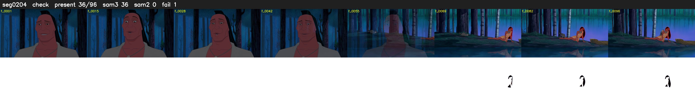

# Segment 204 (shot)

Film frames 18121-18216 (96 frames, 13:35.8-13:39.8).

**Status: check**

| | |
|---|---|
| Frames with her hair | 36 / 96 |
| Mask source | SAM3 36, SAM2 fallback 0 |
| Frames still failing QC | 1 [89] |
| Film indices with no picture (held) | 0 |
| Time | 150 s |

Top: source with the final mask outlined in red. Bottom: white-fill output.

## Issues

- other characters' hair erased on 59 frames
