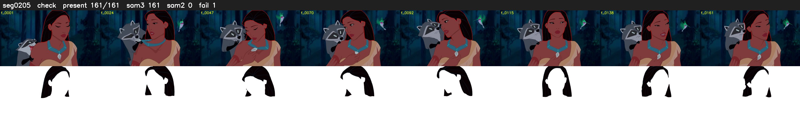

# Segment 205 (shot)

Film frames 18217-18377 (161 frames, 13:39.8-13:46.5).

**Status: check**

| | |
|---|---|
| Frames with her hair | 161 / 161 |
| Mask source | SAM3 161, SAM2 fallback 0 |
| Frames still failing QC | 1 [21] |
| Film indices with no picture (held) | 0 |
| Time | 248 s |

Top: source with the final mask outlined in red. Bottom: white-fill output.
