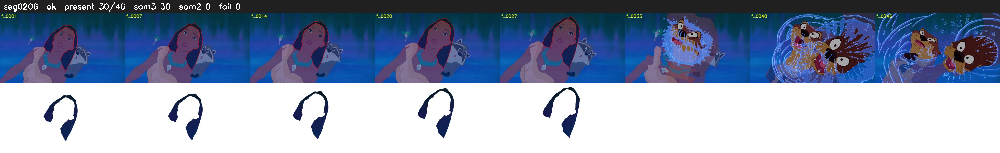

# Segment 206 (shot)

Film frames 18378-18423 (46 frames, 13:46.5-13:48.4).

**Status: ok**

| | |
|---|---|
| Frames with her hair | 30 / 46 |
| Mask source | SAM3 30, SAM2 fallback 0 |
| Frames still failing QC | 0 [] |
| Film indices with no picture (held) | 0 |
| Time | 70 s |

Top: source with the final mask outlined in red. Bottom: white-fill output.

## Issues

- tinted scene: median hair purity 0.04 < 0.5, purity/missed QC off
- other characters' hair erased on 8 frames
