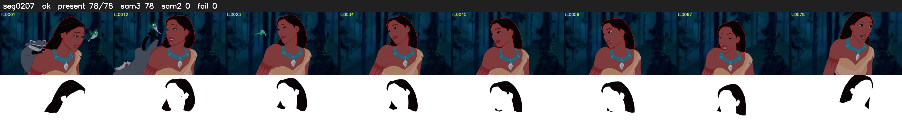

# Segment 207 (shot)

Film frames 18424-18501 (78 frames, 13:48.4-13:51.7).

**Status: ok**

| | |
|---|---|
| Frames with her hair | 78 / 78 |
| Mask source | SAM3 78, SAM2 fallback 0 |
| Frames still failing QC | 0 [] |
| Film indices with no picture (held) | 0 |
| Time | 117 s |

Top: source with the final mask outlined in red. Bottom: white-fill output.
