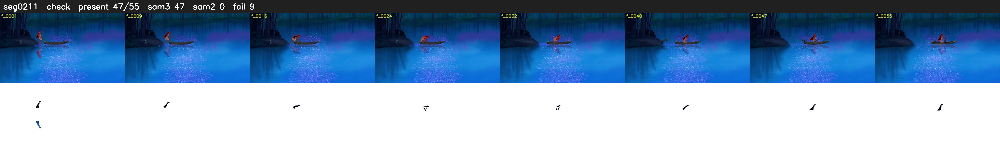

# Segment 211 (shot)

Film frames 18692-18746 (55 frames, 13:59.6-13:01.9).

**Status: check**

| | |
|---|---|
| Frames with her hair | 47 / 55 |
| Mask source | SAM3 47, SAM2 fallback 0 |
| Frames still failing QC | 9 [2, 18, 19, 26, 27, 28, 29, 33, 35] |
| Film indices with no picture (held) | 0 |
| Time | 100 s |

Top: source with the final mask outlined in red. Bottom: white-fill output.

## Issues

- dusk scene: median hair purity 0.71 < 0.75, purity QC off
- fallback 2-2: no seed prompts (cleaned seed too small (1923 px): hair lost)
- fallback 18-19: no seed prompts (cleaned seed too small (1780 px): hair lost)
- fallback 26-29: no seed prompts (cleaned seed too small (915 px): hair lost)
- fallback 33-33: no seed prompts (cleaned seed too small (1105 px): hair lost)
- fallback 35-35: no seed prompts (cleaned seed too small (982 px): hair lost)
- other characters' hair erased on 11 frames
