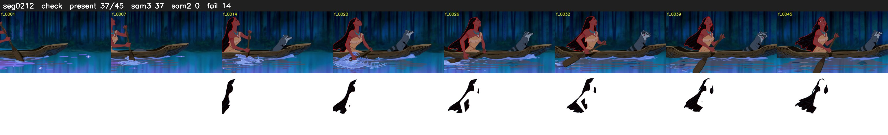

# Segment 212 (shot)

Film frames 18747-18791 (45 frames, 13:01.9-13:03.8).

**Status: check**

| | |
|---|---|
| Frames with her hair | 37 / 45 |
| Mask source | SAM3 37, SAM2 fallback 0 |
| Frames still failing QC | 14 [22, 23, 24, 25, 26, 27, 28, 29, 31, 41, 42, 43, 44, 45] |
| Film indices with no picture (held) | 0 |
| Time | 66 s |

Top: source with the final mask outlined in red. Bottom: white-fill output.
