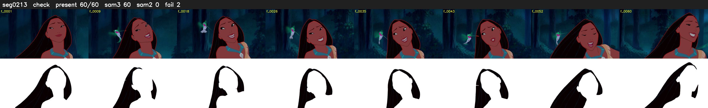

# Segment 213 (shot)

Film frames 18792-18851 (60 frames, 13:03.8-13:06.3).

**Status: check**

| | |
|---|---|
| Frames with her hair | 60 / 60 |
| Mask source | SAM3 60, SAM2 fallback 0 |
| Frames still failing QC | 2 [1, 2] |
| Film indices with no picture (held) | 0 |
| Time | 91 s |

Top: source with the final mask outlined in red. Bottom: white-fill output.
