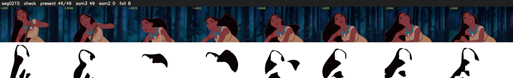

# Segment 215 (shot)

Film frames 18968-19016 (49 frames, 13:11.1-13:13.2).

**Status: check**

| | |
|---|---|
| Frames with her hair | 49 / 49 |
| Mask source | SAM3 49, SAM2 fallback 0 |
| Frames still failing QC | 8 [18, 19, 20, 21, 22, 24, 25, 26] |
| Film indices with no picture (held) | 0 |
| Time | 78 s |

Top: source with the final mask outlined in red. Bottom: white-fill output.
