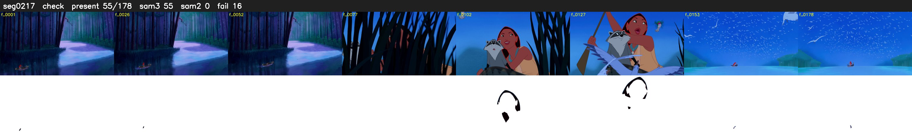

# Segment 217 (shot)

Film frames 19062-19239 (178 frames, 13:15.0-13:22.5).

**Status: check**

| | |
|---|---|
| Frames with her hair | 55 / 178 |
| Mask source | SAM3 55, SAM2 fallback 0 |
| Frames still failing QC | 16 [70, 73, 74, 76, 77, 78, 80, 81, 82, 91, 93, 98, 99, 100, 130, 131] |
| Film indices with no picture (held) | 0 |
| Time | 296 s |

Top: source with the final mask outlined in red. Bottom: white-fill output.

## Issues

- other characters' hair erased on 15 frames
