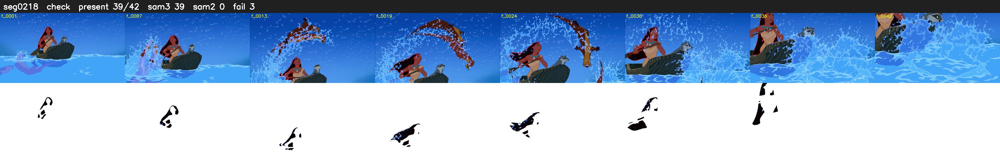

# Segment 218 (shot)

Film frames 19240-19281 (42 frames, 13:22.5-13:24.2).

**Status: check**

| | |
|---|---|
| Frames with her hair | 39 / 42 |
| Mask source | SAM3 39, SAM2 fallback 0 |
| Frames still failing QC | 3 [26, 27, 28] |
| Film indices with no picture (held) | 0 |
| Time | 66 s |

Top: source with the final mask outlined in red. Bottom: white-fill output.

## Issues

- other characters' hair erased on 3 frames
