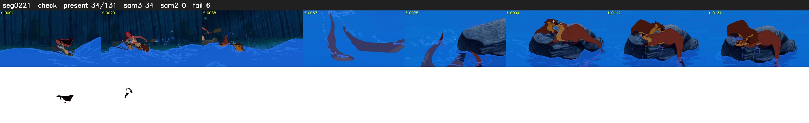

# Segment 221 (shot)

Film frames 19374-19504 (131 frames, 13:28.1-14:33.5).

**Status: check**

| | |
|---|---|
| Frames with her hair | 34 / 131 |
| Mask source | SAM3 34, SAM2 fallback 0 |
| Frames still failing QC | 6 [15, 17, 18, 19, 20, 34] |
| Film indices with no picture (held) | 0 |
| Time | 208 s |

Top: source with the final mask outlined in red. Bottom: white-fill output.

## Issues

- other characters' hair erased on 47 frames
