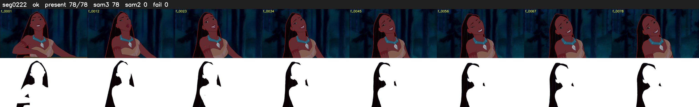

# Segment 222 (shot)

Film frames 19505-19582 (78 frames, 14:33.5-14:36.8).

**Status: ok**

| | |
|---|---|
| Frames with her hair | 78 / 78 |
| Mask source | SAM3 78, SAM2 fallback 0 |
| Frames still failing QC | 0 [] |
| Film indices with no picture (held) | 0 |
| Time | 117 s |

Top: source with the final mask outlined in red. Bottom: white-fill output.

## Issues

- dark scene: 85% of frames fail 'missed', missed QC off
