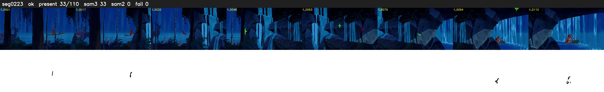

# Segment 223 (shot)

Film frames 19583-19692 (110 frames, 14:36.8-14:41.4).

**Status: ok**

| | |
|---|---|
| Frames with her hair | 33 / 110 |
| Mask source | SAM3 33, SAM2 fallback 0 |
| Frames still failing QC | 0 [] |
| Film indices with no picture (held) | 0 |
| Time | 179 s |

Top: source with the final mask outlined in red. Bottom: white-fill output.

## Issues

- dusk scene: median hair purity 0.71 < 0.75, purity QC off
- other characters' hair erased on 52 frames
