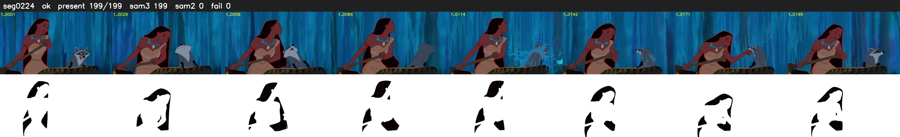

# Segment 224 (shot)

Film frames 19693-19891 (199 frames, 14:41.4-14:49.7).

**Status: ok**

| | |
|---|---|
| Frames with her hair | 199 / 199 |
| Mask source | SAM3 199, SAM2 fallback 0 |
| Frames still failing QC | 0 [] |
| Film indices with no picture (held) | 0 |
| Time | 302 s |

Top: source with the final mask outlined in red. Bottom: white-fill output.
