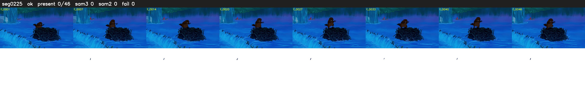

# Segment 225 (shot)

Film frames 19892-19937 (46 frames, 14:49.7-14:51.6).

**Status: ok**

| | |
|---|---|
| Frames with her hair | 0 / 46 |
| Mask source | SAM3 0, SAM2 fallback 0 |
| Frames still failing QC | 0 [] |
| Film indices with no picture (held) | 0 |
| Time | 72 s |

Top: source with the final mask outlined in red. Bottom: white-fill output.
