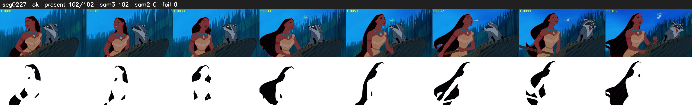

# Segment 227 (shot)

Film frames 20025-20126 (102 frames, 14:55.2-14:59.5).

**Status: ok**

| | |
|---|---|
| Frames with her hair | 102 / 102 |
| Mask source | SAM3 102, SAM2 fallback 0 |
| Frames still failing QC | 0 [] |
| Film indices with no picture (held) | 0 |
| Time | 165 s |

Top: source with the final mask outlined in red. Bottom: white-fill output.
