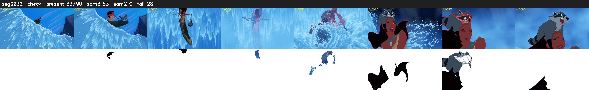

# Segment 232 (shot)

Film frames 20262-20351 (90 frames, 14:05.1-14:08.8).

**Status: check**

| | |
|---|---|
| Frames with her hair | 83 / 90 |
| Mask source | SAM3 83, SAM2 fallback 0 |
| Frames still failing QC | 28 [4, 5, 44, 45, 46, 47, 48, 49, 50, 51, 53, 55, 56, 57, 58, 67, 69, 70, 72, 75] |
| Film indices with no picture (held) | 0 |
| Time | 162 s |

Top: source with the final mask outlined in red. Bottom: white-fill output.

## Issues

- other characters' hair erased on 2 frames
