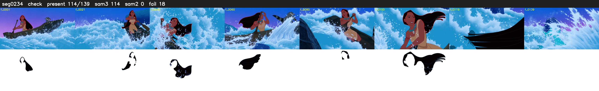

# Segment 234 (shot)

Film frames 20398-20536 (139 frames, 14:10.8-14:16.6).

**Status: check**

| | |
|---|---|
| Frames with her hair | 114 / 139 |
| Mask source | SAM3 114, SAM2 fallback 0 |
| Frames still failing QC | 18 [17, 18, 35, 44, 45, 69, 70, 71, 72, 73, 74, 75, 77, 79, 89, 118, 119, 120] |
| Film indices with no picture (held) | 0 |
| Time | 233 s |

Top: source with the final mask outlined in red. Bottom: white-fill output.

## Issues

- other characters' hair erased on 16 frames
