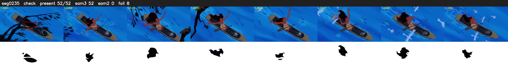

# Segment 235 (shot)

Film frames 20537-20588 (52 frames, 14:16.6-14:18.7).

**Status: check**

| | |
|---|---|
| Frames with her hair | 52 / 52 |
| Mask source | SAM3 52, SAM2 fallback 0 |
| Frames still failing QC | 8 [1, 2, 3, 4, 13, 14, 20, 21] |
| Film indices with no picture (held) | 0 |
| Time | 80 s |

Top: source with the final mask outlined in red. Bottom: white-fill output.
