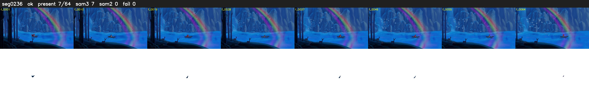

# Segment 236 (shot)

Film frames 20589-20652 (64 frames, 14:18.7-14:21.4).

**Status: ok**

| | |
|---|---|
| Frames with her hair | 7 / 64 |
| Mask source | SAM3 7, SAM2 fallback 0 |
| Frames still failing QC | 0 [] |
| Film indices with no picture (held) | 0 |
| Time | 109 s |

Top: source with the final mask outlined in red. Bottom: white-fill output.

## Issues

- tinted scene: median hair purity 0.00 < 0.5, purity/missed QC off
