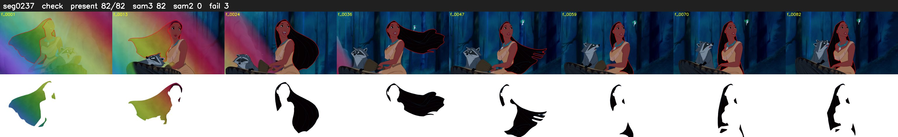

# Segment 237 (shot)

Film frames 20653-20734 (82 frames, 14:21.4-14:24.8).

**Status: check**

| | |
|---|---|
| Frames with her hair | 82 / 82 |
| Mask source | SAM3 82, SAM2 fallback 0 |
| Frames still failing QC | 3 [17, 45, 48] |
| Film indices with no picture (held) | 0 |
| Time | 131 s |

Top: source with the final mask outlined in red. Bottom: white-fill output.
