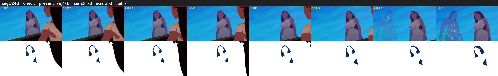

# Segment 240 (shot)

Film frames 20907-20984 (78 frames, 15:32.0-15:35.2).

**Status: check**

| | |
|---|---|
| Frames with her hair | 78 / 78 |
| Mask source | SAM3 78, SAM2 fallback 0 |
| Frames still failing QC | 7 [34, 35, 36, 37, 38, 39, 40] |
| Film indices with no picture (held) | 0 |
| Time | 168 s |

Top: source with the final mask outlined in red. Bottom: white-fill output.

## SAM2 fallbacks

| Frames | Anchor | Direction | SAM2 used |
|---|---|---|---|
| 34-40 | 33 | forward | 0/7 |

## Issues

- other characters' hair erased on 19 frames
