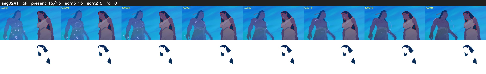

# Segment 241 (transition)

Film frames 20985-20999 (15 frames, 15:35.2-15:35.9).

**Status: ok**

| | |
|---|---|
| Frames with her hair | 15 / 15 |
| Mask source | SAM3 15, SAM2 fallback 0 |
| Frames still failing QC | 0 [] |
| Film indices with no picture (held) | 0 |
| Time | 32 s |

Top: source with the final mask outlined in red. Bottom: white-fill output.

## Issues

- tinted scene: median hair purity 0.00 < 0.5, purity/missed QC off
- other characters' hair erased on 15 frames
