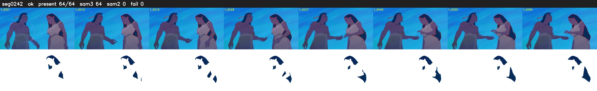

# Segment 242 (shot)

Film frames 21000-21063 (64 frames, 15:35.9-15:38.5).

**Status: ok**

| | |
|---|---|
| Frames with her hair | 64 / 64 |
| Mask source | SAM3 64, SAM2 fallback 0 |
| Frames still failing QC | 0 [] |
| Film indices with no picture (held) | 0 |
| Time | 130 s |

Top: source with the final mask outlined in red. Bottom: white-fill output.

## Issues

- tinted scene: median hair purity 0.00 < 0.5, purity/missed QC off
- other characters' hair erased on 64 frames
