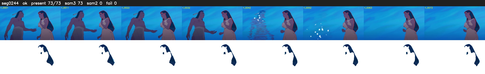

# Segment 244 (shot)

Film frames 21161-21233 (73 frames, 15:42.6-15:45.6).

**Status: ok**

| | |
|---|---|
| Frames with her hair | 73 / 73 |
| Mask source | SAM3 73, SAM2 fallback 0 |
| Frames still failing QC | 0 [] |
| Film indices with no picture (held) | 0 |
| Time | 129 s |

Top: source with the final mask outlined in red. Bottom: white-fill output.

## Issues

- tinted scene: median hair purity 0.00 < 0.5, purity/missed QC off
- other characters' hair erased on 39 frames
