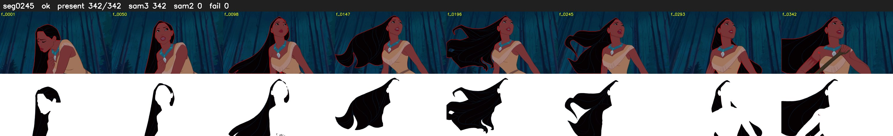

# Segment 245 (shot)

Film frames 21234-21575 (342 frames, 15:45.6-15:59.9).

**Status: ok**

| | |
|---|---|
| Frames with her hair | 342 / 342 |
| Mask source | SAM3 342, SAM2 fallback 0 |
| Frames still failing QC | 0 [] |
| Film indices with no picture (held) | 0 |
| Time | 521 s |

Top: source with the final mask outlined in red. Bottom: white-fill output.
