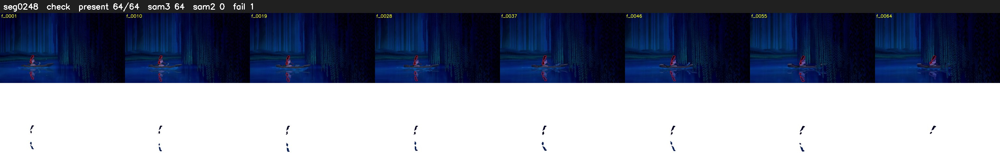

# Segment 248 (shot)

Film frames 21904-21967 (64 frames, 15:13.6-15:16.2).

**Status: check**

| | |
|---|---|
| Frames with her hair | 64 / 64 |
| Mask source | SAM3 64, SAM2 fallback 0 |
| Frames still failing QC | 1 [64] |
| Film indices with no picture (held) | 0 |
| Time | 143 s |

Top: source with the final mask outlined in red. Bottom: white-fill output.

## Issues

- tinted scene: median hair purity 0.30 < 0.5, purity/missed QC off
- fallback 64-64: no seed prompts (cleaned seed too small (1126 px): hair lost)
