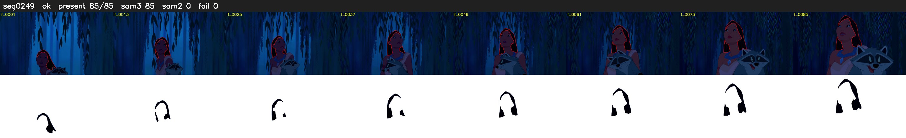

# Segment 249 (shot)

Film frames 21968-22052 (85 frames, 15:16.2-15:19.8).

**Status: ok**

| | |
|---|---|
| Frames with her hair | 85 / 85 |
| Mask source | SAM3 85, SAM2 fallback 0 |
| Frames still failing QC | 0 [] |
| Film indices with no picture (held) | 0 |
| Time | 125 s |

Top: source with the final mask outlined in red. Bottom: white-fill output.
