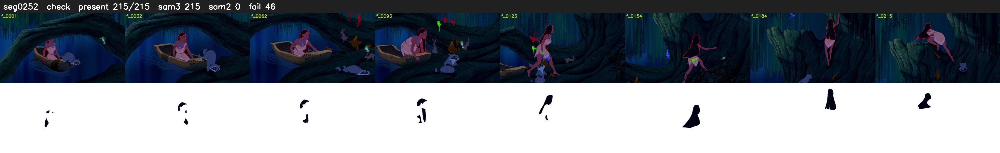

# Segment 252 (shot)

Film frames 22145-22359 (215 frames, 15:23.6-16:32.6).

**Status: check**

| | |
|---|---|
| Frames with her hair | 215 / 215 |
| Mask source | SAM3 215, SAM2 fallback 0 |
| Frames still failing QC | 46 [20, 21, 22, 23, 24, 25, 26, 27, 28, 29, 30, 31, 32, 33, 34, 35, 36, 37, 38, 39] |
| Film indices with no picture (held) | 0 |
| Time | 349 s |

Top: source with the final mask outlined in red. Bottom: white-fill output.

## Issues

- dark scene: 54% of frames fail 'missed', missed QC off
