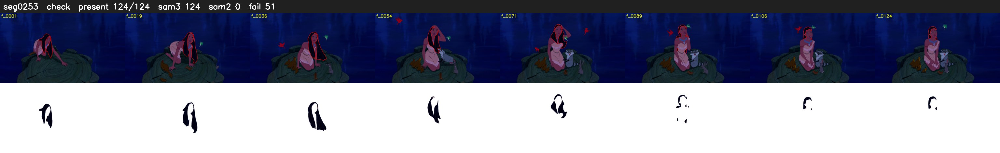

# Segment 253 (shot)

Film frames 22360-22483 (124 frames, 16:32.6-16:37.8).

**Status: check**

| | |
|---|---|
| Frames with her hair | 124 / 124 |
| Mask source | SAM3 124, SAM2 fallback 0 |
| Frames still failing QC | 51 [1, 2, 3, 5, 6, 7, 8, 9, 10, 11, 12, 13, 14, 15, 16, 17, 18, 19, 20, 21] |
| Film indices with no picture (held) | 0 |
| Time | 190 s |

Top: source with the final mask outlined in red. Bottom: white-fill output.

## Issues

- manual override: SAM2 f106 covered the whole night sky beside her (199k px, purity 0)
