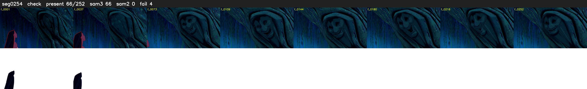

# Segment 254 (shot)

Film frames 22484-22735 (252 frames, 16:37.8-16:48.3).

**Status: check**

| | |
|---|---|
| Frames with her hair | 66 / 252 |
| Mask source | SAM3 66, SAM2 fallback 0 |
| Frames still failing QC | 4 [62, 63, 64, 65] |
| Film indices with no picture (held) | 0 |
| Time | 458 s |

Top: source with the final mask outlined in red. Bottom: white-fill output.

## Issues

- other characters' hair erased on 171 frames
