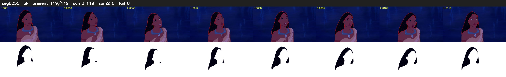

# Segment 255 (shot)

Film frames 22736-22854 (119 frames, 16:48.3-16:53.2).

**Status: ok**

| | |
|---|---|
| Frames with her hair | 119 / 119 |
| Mask source | SAM3 119, SAM2 fallback 0 |
| Frames still failing QC | 0 [] |
| Film indices with no picture (held) | 0 |
| Time | 173 s |

Top: source with the final mask outlined in red. Bottom: white-fill output.
