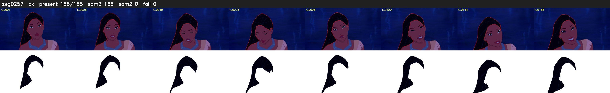

# Segment 257 (shot)

Film frames 22941-23108 (168 frames, 16:56.8-16:03.8).

**Status: ok**

| | |
|---|---|
| Frames with her hair | 168 / 168 |
| Mask source | SAM3 168, SAM2 fallback 0 |
| Frames still failing QC | 0 [] |
| Film indices with no picture (held) | 0 |
| Time | 253 s |

Top: source with the final mask outlined in red. Bottom: white-fill output.
