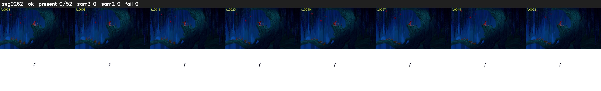

# Segment 262 (shot)

Film frames 23309-23360 (52 frames, 16:12.2-16:14.3).

**Status: ok**

| | |
|---|---|
| Frames with her hair | 0 / 52 |
| Mask source | SAM3 0, SAM2 fallback 0 |
| Frames still failing QC | 0 [] |
| Film indices with no picture (held) | 0 |
| Time | 81 s |

Top: source with the final mask outlined in red. Bottom: white-fill output.
