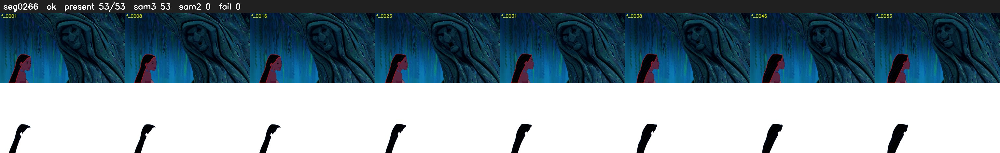

# Segment 266 (shot)

Film frames 23497-23549 (53 frames, 16:20.0-16:22.2).

**Status: ok**

| | |
|---|---|
| Frames with her hair | 53 / 53 |
| Mask source | SAM3 53, SAM2 fallback 0 |
| Frames still failing QC | 0 [] |
| Film indices with no picture (held) | 0 |
| Time | 84 s |

Top: source with the final mask outlined in red. Bottom: white-fill output.
