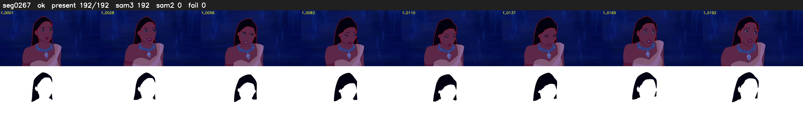

# Segment 267 (shot)

Film frames 23550-23741 (192 frames, 16:22.2-17:30.2).

**Status: ok**

| | |
|---|---|
| Frames with her hair | 192 / 192 |
| Mask source | SAM3 192, SAM2 fallback 0 |
| Frames still failing QC | 0 [] |
| Film indices with no picture (held) | 0 |
| Time | 286 s |

Top: source with the final mask outlined in red. Bottom: white-fill output.
