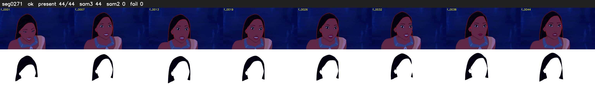

# Segment 271 (shot)

Film frames 23918-23961 (44 frames, 17:37.6-17:39.4).

**Status: ok**

| | |
|---|---|
| Frames with her hair | 44 / 44 |
| Mask source | SAM3 44, SAM2 fallback 0 |
| Frames still failing QC | 0 [] |
| Film indices with no picture (held) | 0 |
| Time | 65 s |

Top: source with the final mask outlined in red. Bottom: white-fill output.
