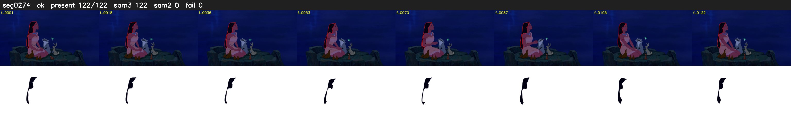

# Segment 274 (shot)

Film frames 24186-24307 (122 frames, 17:48.8-17:53.8).

**Status: ok**

| | |
|---|---|
| Frames with her hair | 122 / 122 |
| Mask source | SAM3 122, SAM2 fallback 0 |
| Frames still failing QC | 0 [] |
| Film indices with no picture (held) | 0 |
| Time | 184 s |

Top: source with the final mask outlined in red. Bottom: white-fill output.
