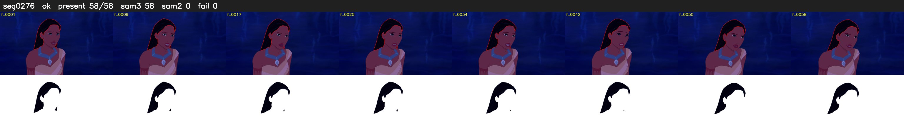

# Segment 276 (shot)

Film frames 24422-24479 (58 frames, 17:58.6-17:01.0).

**Status: ok**

| | |
|---|---|
| Frames with her hair | 58 / 58 |
| Mask source | SAM3 58, SAM2 fallback 0 |
| Frames still failing QC | 0 [] |
| Film indices with no picture (held) | 0 |
| Time | 89 s |

Top: source with the final mask outlined in red. Bottom: white-fill output.
