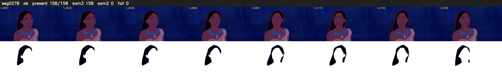

# Segment 278 (shot)

Film frames 24624-24781 (158 frames, 17:07.0-17:13.6).

**Status: ok**

| | |
|---|---|
| Frames with her hair | 158 / 158 |
| Mask source | SAM3 158, SAM2 fallback 0 |
| Frames still failing QC | 0 [] |
| Film indices with no picture (held) | 0 |
| Time | 230 s |

Top: source with the final mask outlined in red. Bottom: white-fill output.
