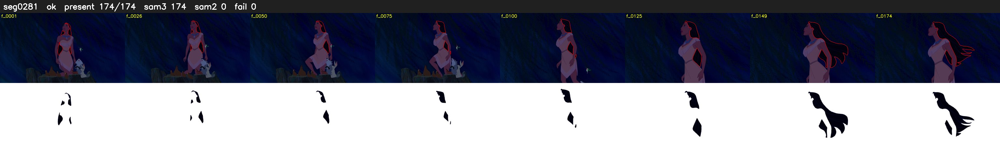

# Segment 281 (shot)

Film frames 24916-25089 (174 frames, 17:19.2-17:26.5).

**Status: ok**

| | |
|---|---|
| Frames with her hair | 174 / 174 |
| Mask source | SAM3 174, SAM2 fallback 0 |
| Frames still failing QC | 0 [] |
| Film indices with no picture (held) | 0 |
| Time | 269 s |

Top: source with the final mask outlined in red. Bottom: white-fill output.

## Issues

- dark scene: 59% of frames fail 'missed', missed QC off
