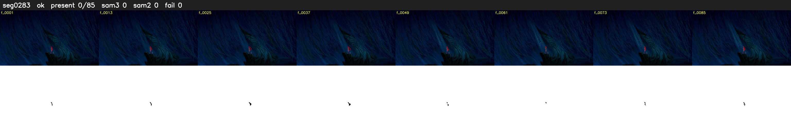

# Segment 283 (shot)

Film frames 25176-25260 (85 frames, 18:30.0-18:33.6).

**Status: ok**

| | |
|---|---|
| Frames with her hair | 0 / 85 |
| Mask source | SAM3 0, SAM2 fallback 0 |
| Frames still failing QC | 0 [] |
| Film indices with no picture (held) | 0 |
| Time | 140 s |

Top: source with the final mask outlined in red. Bottom: white-fill output.
