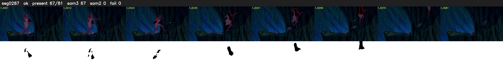

# Segment 287 (shot)

Film frames 25680-25760 (81 frames, 18:51.1-18:54.4).

**Status: ok**

| | |
|---|---|
| Frames with her hair | 67 / 81 |
| Mask source | SAM3 67, SAM2 fallback 0 |
| Frames still failing QC | 0 [] |
| Film indices with no picture (held) | 0 |
| Time | 129 s |

Top: source with the final mask outlined in red. Bottom: white-fill output.

## Issues

- other characters' hair erased on 3 frames
