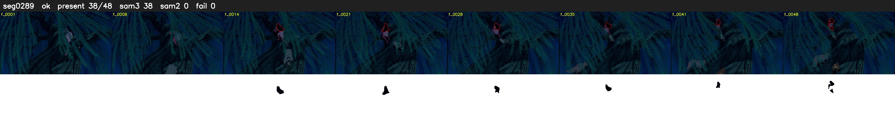

# Segment 289 (shot)

Film frames 25812-25859 (48 frames, 18:56.6-18:58.6).

**Status: ok**

| | |
|---|---|
| Frames with her hair | 38 / 48 |
| Mask source | SAM3 38, SAM2 fallback 0 |
| Frames still failing QC | 0 [] |
| Film indices with no picture (held) | 0 |
| Time | 81 s |

Top: source with the final mask outlined in red. Bottom: white-fill output.

## Issues

- dark scene: 92% of frames fail 'missed', missed QC off
- other characters' hair erased on 6 frames
