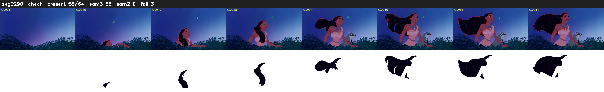

# Segment 290 (shot)

Film frames 25860-25923 (64 frames, 18:58.6-18:01.2).

**Status: check**

| | |
|---|---|
| Frames with her hair | 58 / 64 |
| Mask source | SAM3 58, SAM2 fallback 0 |
| Frames still failing QC | 3 [7, 8, 9] |
| Film indices with no picture (held) | 0 |
| Time | 101 s |

Top: source with the final mask outlined in red. Bottom: white-fill output.

## Issues

- other characters' hair erased on 5 frames
