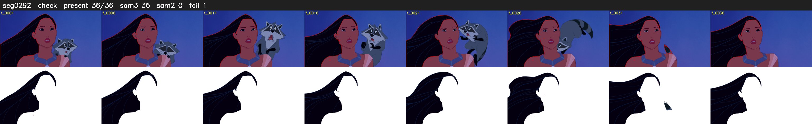

# Segment 292 (shot)

Film frames 25958-25993 (36 frames, 18:02.7-18:04.2).

**Status: check**

| | |
|---|---|
| Frames with her hair | 36 / 36 |
| Mask source | SAM3 36, SAM2 fallback 0 |
| Frames still failing QC | 1 [27] |
| Film indices with no picture (held) | 0 |
| Time | 60 s |

Top: source with the final mask outlined in red. Bottom: white-fill output.

## SAM2 fallbacks

| Frames | Anchor | Direction | SAM2 used |
|---|---|---|---|
| 27-27 | 26 | forward | 0/1 |
