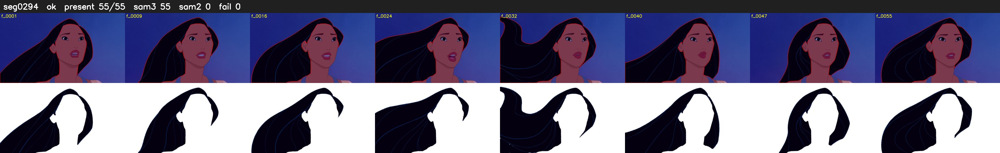

# Segment 294 (shot)

Film frames 26058-26112 (55 frames, 18:06.8-18:09.1).

**Status: ok**

| | |
|---|---|
| Frames with her hair | 55 / 55 |
| Mask source | SAM3 55, SAM2 fallback 0 |
| Frames still failing QC | 0 [] |
| Film indices with no picture (held) | 0 |
| Time | 82 s |

Top: source with the final mask outlined in red. Bottom: white-fill output.
