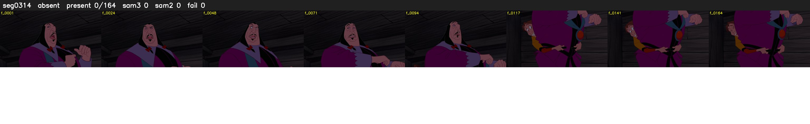

# Segment 314 (shot)

Film frames 27774-27937 (164 frames, 19:18.4-19:25.2).

**Status: absent**

| | |
|---|---|
| Frames with her hair | 0 / 164 |
| Mask source | SAM3 0, SAM2 fallback 0 |
| Frames still failing QC | 0 [] |
| Film indices with no picture (held) | 0 |
| Time | 54 s |

Top: source with the final mask outlined in red. Bottom: white-fill output.

## Issues

- hair on 28/28 presence frames, none of it hers (best P 0.01)
