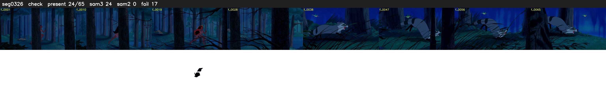

# Segment 326 (shot)

Film frames 29055-29119 (65 frames, 20:11.8-20:14.5).

**Status: check**

| | |
|---|---|
| Frames with her hair | 24 / 65 |
| Mask source | SAM3 24, SAM2 fallback 0 |
| Frames still failing QC | 17 [2, 3, 9, 10, 11, 12, 13, 14, 15, 16, 19, 20, 27, 28, 29, 32, 33] |
| Film indices with no picture (held) | 0 |
| Time | 107 s |

Top: source with the final mask outlined in red. Bottom: white-fill output.

## Issues

- other characters' hair erased on 35 frames
