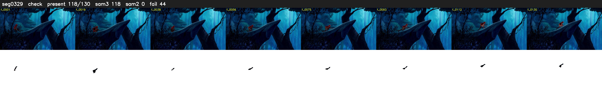

# Segment 329 (shot)

Film frames 29272-29401 (130 frames, 20:20.9-20:26.3).

**Status: check**

| | |
|---|---|
| Frames with her hair | 118 / 130 |
| Mask source | SAM3 118, SAM2 fallback 0 |
| Frames still failing QC | 44 [1, 2, 3, 4, 5, 6, 7, 8, 9, 10, 11, 12, 13, 14, 15, 16, 17, 18, 19, 20] |
| Film indices with no picture (held) | 0 |
| Time | 219 s |

Top: source with the final mask outlined in red. Bottom: white-fill output.

## Issues

- fallback 1-44: no seed prompts (cleaned seed too small (1566 px): hair lost)
